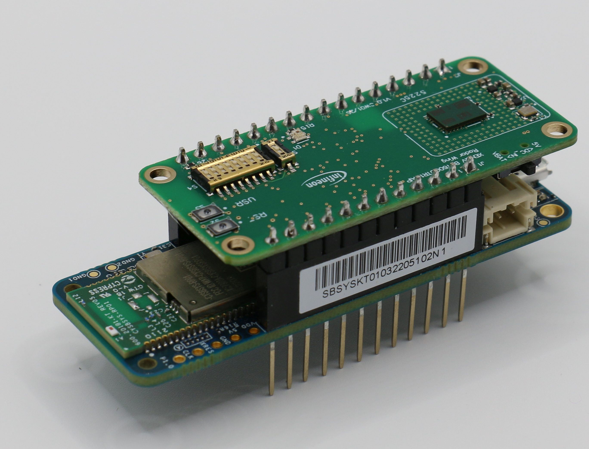

# PSOC&trade; 6 MCU: Stream on-chip DSP output like ADC, range or Doppler FFT data from the XENSIV&trade; 60 GHz Radar

This code example streams the DSP output of the radar sensor's on-chip motion detector. The sensor computes the FFT on
chip, forwards the result into its FIFO, and the firmware moves it to the host over SEGGER RTT without ever converting
it.

With a single `#define` in *main.c* users select which DSP sensor output is forwarded to the FIFO and fetched there.
Users select the forwarded DSP outputs by editing `DSP_STAGES` in `main.c`:

```c
#define DSP_STAGES (DSP_STAGE_ADC)
#define DSP_STAGES (DSP_STAGE_RFFT)
#define DSP_STAGES (DSP_STAGE_DFFT)
```

- ADC = Analog/Digital converter samples
- RFFT = Range FFT
- DFFT = Doppler FFT

Then rebuild and flash the application. The firmware derives the FIFO forwarding mask, frame size, buffer size, and RTT
metadata automatically. No host firmware change is required; `get_info` reports the enabled `adc`, `rfft`, and `dfft`
section lengths.

**Notes:**
- The default radar configuration enables ADC, RFFT and DFFT algo in `MD_RD_ALG_CTRL` sensor register.
- The firmware just overrides the `MD_RD_FIFO_CTRL` bits to select which algo output is forwarded to the sensor FIFO.

**Radar config limitations:**
- In contrast to the `fifo-read` example, this firmware requires a motion detector sensor config.
- It expects a sensor config where sequence 2 (RD) is configured.
- ADC configs (sequence 0) and ULP configs (sequence 0) are not supported!
- Also MTI must be disabled.

**Platform**: This is the CSK (Connected Sensor Kit) bare-metal version for CYSBSYSKIT-DEV-01. Key features:
- Uses SPI frequency of 18.75 MHz
- DEBUG UART pins for communication
- LED toggling to indicate FIFO read activity
- FIFO integrity checking (overflow, underflow, threshold events)
- 5-second UART initialization delay
- Sensor initialized in active mode (`ACTIVE_MODE`) with power down disabled

[View this README on GitHub.](replace_code_example_github_readme_url)

[Provide feedback on this code example.](replace_code_example_voc_survey_url)

## Requirements

- [ModusToolbox&trade;](https://www.infineon.com/modustoolbox) v3.4 or later (tested with v3.4)
- Board support package (BSP) minimum required version: 5.0.0
- Programming language: C
- Associated parts: All [PSOC&trade; 6 MCU](https://www.infineon.com/cms/en/product/microcontroller/32-bit-psoc-arm-cortex-microcontroller/psoc-6-32-bit-arm-cortex-m4-mcu) parts

## Supported toolchains (make variable 'TOOLCHAIN')

- GNU Arm&reg; Embedded Compiler v11.3.1 (`GCC_ARM`) – Default value of `TOOLCHAIN`
- Arm&reg; Compiler v6.22 (`ARM`)
- IAR C/C++ Compiler v9.50.2 (`IAR`)

## Supported kits (make variable 'TARGET')

- [Rapid IoT connect developer kit](https://github.com/Infineon/TARGET_CYSBSYSKIT-DEV-01) (`CYSBSYSKIT-DEV-01`) – Default value of `TARGET`

## Hardware setup

### For Rapid IoT Connect Developer Kit

This code example requires the XENSIV&trade; BGT60CUTR13AIP Radar Wing Board as part of the connected sensor kit.

1. Connect the radar Wing board to the CYSBSYSKIT-DEV-01 kit through the pin headers.

2. Connect the CYSBSYSKIT-DEV-01 kit to the PC with the USB cable.

   **Figure 1. Rapid IoT Connect Developer Kit**

   


3. Place the CYSBSYSKIT-DEV-01 kit at a fixed location (for example, the corner of a room) to ensure optimal performance of the presence detection application.

## Software setup

See the [ModusToolbox&trade; tools package installation guide](https://www.infineon.com/ModusToolboxInstallguide) for information about installing and configuring the tools package.


Install a terminal emulator if you do not have one. Instructions in this document use [Tera Term](https://teratermproject.github.io/index-en.html).

This example requires no additional software or tools.


## Using the code example


### Create the project

The ModusToolbox&trade; tools package provides the Project Creator as both a GUI tool and a command line tool.

<details><summary><b>Use Project Creator GUI</b></summary>

1. Open the Project Creator GUI tool

   There are several ways to do this, including launching it from the dashboard or from inside the Eclipse IDE. For more details, see the [Project Creator user guide](https://www.infineon.com/ModusToolboxProjectCreator) (locally available at *{ModusToolbox&trade; install directory}/tools_{version}/project-creator/docs/project-creator.pdf*)

2. On the **Choose Board Support Package (BSP)** page, select a kit supported by this code example. See [Supported kits](#supported-kits-make-variable-target)

   > **Note:** To use this code example for a kit not listed here, you may need to update the source files. If the kit does not have the required resources, the application may not work

3. On the **Select Application** page:

   a. Select the **Applications(s) Root Path** and the **Target IDE**

      > **Note:** Depending on how you open the Project Creator tool, these fields may be pre-selected for you

   b. Select this code example from the list by enabling its check box

      > **Note:** You can narrow the list of displayed examples by typing in the filter box

   c. (Optional) Change the suggested **New Application Name** and **New BSP Name**

   d. Click **Create** to complete the application creation process

</details>


<details><summary><b>Use Project Creator CLI</b></summary>

The 'project-creator-cli' tool can be used to create applications from a CLI terminal or from within batch files or shell scripts. This tool is available in the *{ModusToolbox&trade; install directory}/tools_{version}/project-creator/* directory.

Use a CLI terminal to invoke the 'project-creator-cli' tool. On Windows, use the command-line 'modus-shell' program provided in the ModusToolbox&trade; installation instead of a standard Windows command-line application. This shell provides access to all ModusToolbox&trade; tools. You can access it by typing "modus-shell" in the search box in the Windows menu. In Linux and macOS, you can use any terminal application.

The following example clones the "[FIFO Read](https://github.com/Infineon/mtb-example-psoc6-cmos-radar-fifo-read)" application with the desired name "my-fifo-read" configured for the *CYSBSYSKIT-DEV-01* BSP into the specified working directory, *./mtb_projects*:

   ```
   project-creator-cli --board-id CYSBSYSKIT-DEV-01 --app-id mtb-example-psoc6-cmos-radar-fifo-read --user-app-name my-fifo-read --target-dir ./mtb_projects
   ```

The 'project-creator-cli' tool has the following arguments:

Argument | Description | Required/optional
---------|-------------|-----------
`--board-id` | Defined in the <id> field of the [BSP](https://github.com/Infineon?q=bsp-manifest&type=&language=&sort=) manifest | Required
`--app-id`   | Defined in the <id> field of the [CE](https://github.com/Infineon?q=ce-manifest&type=&language=&sort=) manifest | Required
`--target-dir`| Specify the directory in which the application is to be created if you prefer not to use the default current working directory | Optional
`--user-app-name`| Specify the name of the application if you prefer to have a name other than the example's default name | Optional

<br>

> **Note:** The project-creator-cli tool uses the `git clone` and `make getlibs` commands to fetch the repository and import the required libraries. For details, see the "Project creator tools" section of the [ModusToolbox&trade; tools package user guide](https://www.infineon.com/ModusToolboxUserGuide) (locally available at {ModusToolbox&trade; install directory}/docs_{version}/mtb_user_guide.pdf).

</details>


### Open the project

After the project has been created, you can open it in your preferred development environment.


<details><summary><b>Eclipse IDE</b></summary>

If you opened the Project Creator tool from the included Eclipse IDE, the project will open in Eclipse automatically.

For more details, see the [Eclipse IDE for ModusToolbox&trade; user guide](https://www.infineon.com/MTBEclipseIDEUserGuide) (locally available at *{ModusToolbox&trade; install directory}/docs_{version}/mt_ide_user_guide.pdf*).

</details>


<details><summary><b>Visual Studio (VS) Code</b></summary>

Launch VS Code manually, and then open the generated *{project-name}.code-workspace* file located in the project directory.

For more details, see the [Visual Studio Code for ModusToolbox&trade; user guide](https://www.infineon.com/MTBVSCodeUserGuide) (locally available at *{ModusToolbox&trade; install directory}/docs_{version}/mt_vscode_user_guide.pdf*).

</details>


<details><summary><b>Arm&reg; Keil&reg; µVision&reg;</b></summary>

Double-click the generated *{project-name}.cprj* file to launch the Keil&reg; µVision&reg; IDE.

For more details, see the [Arm&reg; Keil&reg; µVision&reg; for ModusToolbox&trade; user guide](https://www.infineon.com/MTBuVisionUserGuide) (locally available at *{ModusToolbox&trade; install directory}/docs_{version}/mt_uvision_user_guide.pdf*).

</details>


<details><summary><b>IAR Embedded Workbench</b></summary>

Open IAR Embedded Workbench manually, and create a new project. Then select the generated *{project-name}.ipcf* file located in the project directory.

For more details, see the [IAR Embedded Workbench for ModusToolbox&trade; user guide](https://www.infineon.com/MTBIARUserGuide) (locally available at *{ModusToolbox&trade; install directory}/docs_{version}/mt_iar_user_guide.pdf*).

</details>


<details><summary><b>Command line</b></summary>

If you prefer to use the CLI, open the appropriate terminal, and navigate to the project directory. On Windows, use the command-line 'modus-shell' program; on Linux and macOS, you can use any terminal application. From there, you can run various `make` commands.

For more details, see the [ModusToolbox&trade; tools package user guide](https://www.infineon.com/ModusToolboxUserGuide) (locally available at *{ModusToolbox&trade; install directory}/docs_{version}/mtb_user_guide.pdf*).

</details>


## Operation


If using a PSOC&trade; 64 "Secure" MCU kit (like CY8CKIT-064B0S2-4343W), the PSOC&trade; 64 device must be provisioned with keys and policies before being programmed. Follow the instructions in the ["Secure Boot" SDK user guide](https://www.infineon.com/dgdlac/Infineon-PSoC_64_Secure_MCU_Secure_Boot_SDK_User_Guide-Software-v07_00-EN.pdf?fileId=8ac78c8c7d0d8da4017d0f8c361a7666) to provision the device. If the kit is already provisioned, copy-paste the keys and policy folder to the application folder.

1. Connect the board to your PC using the provided USB cable through the KitProg3 USB connector

2. Open a terminal program and select the KitProg3 COM port. Set the serial port parameters to 8N1 and 2000000 baud

3. Program the board using one of the following:

   <details><summary><b>Using Eclipse IDE</b></summary>

      1. Select the application project in the Project Explorer

      2. In the **Quick Panel**, scroll down, and click **\<Application Name> Program (KitProg3_MiniProg4)**
   </details>


   <details><summary><b>In other IDEs</b></summary>

   Follow the instructions in your preferred IDE

   </details>


   <details><summary><b>Using CLI</b></summary>

     From the terminal, execute the `make program` command to build and program the application using the default toolchain to the default target. The default toolchain is specified in the application's Makefile but you can override this value manually:
      ```
      make program TOOLCHAIN=<toolchain>
      ```

      Example:
      ```
      make program TOOLCHAIN=GCC_ARM
      ```
   </details>

4. After programming, the application starts automatically. Confirm that "\<CE Title>" is displayed on the UART terminal


   **Terminal output on program startup**

   ```
   {"info":"***************************************************************"}
   {"info":"Radar: On-Chip Data Streaming via RTT Example (ADC, RFFT, DFFT)"}
   {"info":"***************************************************************"}
   {"info":"For more projects, visit our code examples repositories:"}
   {"info":"https://github.com/Infineon/Code-Examples-for-ModusToolbox-Software"}
   Xensiv radar device detected
   XENSIV radar configuration done
   {"info":"Radar sensor is initialized"}
   {"info":"Radar frame size: 6144 FIFO words"}
   {"info":"FIFO IRQ threshold: 3072 FIFO words"}
   {"info":"Radar frame slices: 2"}
   {"info":"Radar data acquisition started"}
   ```


5. Confirm that the green wing board LED blinks as radar frames are read.

## Debugging

You can debug the example to step through the code.

<details><summary><b>In Eclipse IDE</b></summary>

Use the **\<Application Name> Debug (KitProg3_MiniProg4)** configuration in the **Quick Panel**. For details, see the "Program and debug" section in the [Eclipse IDE for ModusToolbox&trade; user guide](https://www.infineon.com/MTBEclipseIDEUserGuide).

> **Note:** **(Only while debugging)** On the CM4 CPU, some code in `main()` may execute before the debugger halts at the beginning of `main()`. This means that some code executes twice – once before the debugger stops execution, and again after the debugger resets the program counter to the beginning of `main()`. See [KBA231071](https://community.infineon.com/docs/DOC-21143) to learn about this and for the workaround.

</details>


<details><summary><b>In other IDEs</b></summary>

Follow the instructions in your preferred IDE.

</details>

## Design and implementation

### Reading the stream on a PC

Radar frames leave the board on RTT channel 1, not over the UART. The UART carries only the JSON control protocol, so a terminal shows the start-up lines and the `get_info` reply while the frames flow past it through the debug probe.

Attach any RTT host tool to the control block address the board reports and read the stream as a sequence of RTT Stream Frames: a 15-byte header of `[START]`, a little-endian `uint32` frame number and a little-endian `uint32` payload length, followed by the payload itself. A frame is written whole or not at all, so a gap in the frame numbers means a complete frame was dropped, never half of one.

The sensor DSP data (ADC or range FFT or Doppler FFT) is streamed undecoded to the host via SEGGER's Real Time Transport (RTT) interface.

The DSP data is prefixed by the following data: `[START]<rtt_frame_number_zero_to_n><dsp_payload>`
- The literal string `[START]` to mark the beginning of a RTT frame.
- A consecutive RTT frame number to detect frame losses (32 bit little endian)
- The actual DSP payload

**Watch out:** The DSP payload is undecoded and must be decoded on host side (e.g. by our GUI, the [XENSIV™ CMOS Radar Visualization Tool](https://softwaretools.infineon.com/tools/com.ifx.tb.tool.xensivcmosradarvisualizationtool)). See the sensor user guide (also shipped with the GUI) how to decode the data.
- ADC samples are bit-reversed unsigned Q12.4 values.
- RFFT bins are signed Q0.31 complex values (real, then imaginary); honor `rtt.msb_aligned`.
- DFFT bins are signed Q0.31 complex values (real, then imaginary); honor `rtt.msb_aligned`.

### Choosing what the FIFO forwards

The sensor's processing chain can forward any of its stages to the FIFO, selected by `MD_RD_FIFO_CTRL`. This example writes that register itself, right after the register configuration has been applied, so one configuration serves every data path. Set `DSP_STAGES` in *main.c* to one stage or to a combination of them:

Stage | Forwarded stage | Frame | FIFO words | Payload
:------- | :-------------- | :---- | :--------- | :------
`DSP_STAGE_RFFT` | `RFFT_EN`, the range FFT output | 3 RX &times; 32 bins &times; 32 bursts, real and imaginary | 6144 | 24576 bytes
`DSP_STAGE_DFFT` | `CFFT_EN`, the Doppler FFT output | 3 RX &times; 32 range &times; 32 Doppler bins, real and imaginary | 6144 | 24576 bytes
`DSP_STAGE_ADC` | `AVG_EN`, the averaged ADC samples the FFTs were computed from | 3 RX &times; 32 bursts &times; 64 samples | 6144 | 24576 bytes

Everything else follows from the configuration header, so no path repeats a number that the register list already fixes. `dsp_chain.c` turns the selection into the register value and the section sizes, and *tests/on-chip-md-data-streaming/uut* covers that arithmetic.

The ADC setting exists to make the FFTs checkable: it streams the same acquisition one stage earlier, which is what lets a host compute the FFT itself and compare.

**Combining stages.** The sensor forwards a stage as soon as it has finished it, which decides what can be streamed together. The averaged ADC samples and the range FFT are both produced per burst, so they alternate inside a frame and the host cannot tell the two apart; selecting both is rejected at compile time. The Doppler FFT runs once the frame is complete and therefore always forms one block at the end, so `DSP_STAGE_RFFT | DSP_STAGE_DFFT` and `DSP_STAGE_ADC | DSP_STAGE_DFFT` stream as two clean sections.

The RTT up-buffer is sized in RAM and holds whole frames only, so the wider the selection, the fewer frames it can absorb while a host is busy: five ADC frames, but only two range plus Doppler FFT ones.

### One radar frame, several interrupts

The FIFO threshold interrupt fires every 3072 words, one past `FIFO_THRESHOLD`. A range FFT frame is 6144 words, so it arrives as **two** slices and the application must join them; the averaged ADC frame is 6144 words as well, because a forwarded processing stage occupies a full 32-bit word per sample; range plus Doppler FFT together take four slices. Every supported selection is a whole number of interrupts, which the application checks at start-up rather than assuming — an indivisible frame size would misalign the stream silently.

`frame_assembler.c` tracks which slice is next. Its one real responsibility is error recovery: a FIFO overflow or a failed read discards the partial frame instead of completing it, because an orphaned slice would otherwise be paired with the first slice of the next acquisition and every later frame would stay misaligned. That behaviour is covered by *tests/on-chip-md-data-streaming/uut*.

### The `rtt` block in the `get_info` response

A host needs the address of the RTT control block to attach without searching target memory, and the acquisition geometry to reshape the payload. The `get_info` reply carries both:

```json
"rtt": {
  "addr": "0x08001234",
  "data_and_payload_length_bytes": {"adc": 0, "rfft": 24576, "dfft": 0},
  "msb_aligned": true,
  "radar_config": {"num_tx": 1, "num_rx": 3, "num_chirps": 32, "num_samples_per_chirp": 64, "range_resolution_m": 0.365279}
}
```

`range_resolution_m` is the distance between two range bins, taken from `RD_RANGE_RESOLUTION_M` in the configuration header. A host needs it to label the range axis of the spectrum in meters, so it is reported rather than left to a device configuration file on the PC side. An application that does not know its range resolution reports `0`.

The bin counts are not reported because they follow from the acquisition parameters: a range FFT has `num_samples_per_chirp / 2` bins and the Doppler FFT has `num_chirps` of them. The firmware checks `MD_RD_CTRL.RFFT_SIZE` and `MD_RD_CTRL.CFFT_SIZE` against those two values at start-up and refuses to stream when they disagree, because a register configuration that changed an FFT size would otherwise reshape every frame the host decodes without anything looking wrong.

`data_and_payload_length_bytes` is an ordered map: the key order is the on-wire section order and a length of `0` marks a section as disabled. Changing `DSP_STAGES` changes which sections are non-zero, so a host can follow the firmware without being rebuilt.

### Decoding the payload

The firmware streams the FIFO words verbatim and leaves the arithmetic to the host, which has the floating point to spare.

A range FFT payload is a sequence of little-endian 32-bit words ordered **burst, then receive antenna, then bin**, with each bin contributing its real part followed by its imaginary part:

```python
import numpy as np

words = np.frombuffer(payload, dtype="<u4")              # 6144 words
if not info["rtt"]["msb_aligned"]:
    words = words << 8                                   # left-align before scaling
value = words.astype(np.int32) / 2**31                   # Q0.31
frame = value.reshape(num_chirps, num_rx, num_bins, 2)   # 32, 3, 32, (re, im)
spectrum = frame[..., 0] + 1j * frame[..., 1]
```

`num_bins` is `num_samples_per_chirp / 2`: a real FFT of N real samples has N/2 distinct complex bins and the rest is their mirror image. Bin 0 is the DC component, and the bins are spaced by `range_resolution_m` from the `rtt` block, 0.365 m here.

A Doppler FFT payload follows the same word format but is ordered **receive antenna, then range bin, then Doppler bin**:

```python
frame = value.reshape(num_rx, num_bins, num_chirps, 2)   # 3, 32, 32, (re, im)
range_doppler = frame[..., 0] + 1j * frame[..., 1]
range_doppler = np.fft.fftshift(range_doppler, axes=-1)  # zero Doppler to the centre
```

The sensor forwards the Doppler FFT unreordered, so the zero frequency sits at the edges of the Doppler axis until the host shifts it.

When both sections are streamed, split the payload at the section lengths from `data_and_payload_length_bytes` before reshaping either one.

Take `msb_aligned` from the `rtt` block rather than assuming it. It reports `SPI_CTRL.MSB_ALIGN_EN` as the sensor is actually configured, and the sibling `fifo-read` example reports the opposite value.

> **Note:** The default radar configuration leaves `MD_RD_ALG_CTRL.WIN_EN` disabled, so no window is applied before the range FFT. A strong target therefore smears across neighbouring bins. Enable windowing in the register configuration if the sidelobes matter for your use case.


### Resources and settings

**Table 1. Application resources**

 Resource  |  Alias/object     |    Purpose
 :-------- | :-------------    | :------------
 UART (HAL)|cy_retarget_io_uart_obj| UART HAL object used by Retarget-IO for the Debug UART port
 GPIO (HAL)    | CYBSP_USER_LED     | User LED
 GPIO (HAL)    | SHIELD_XENSIV_RADAR_LED_GREEN | Lit while a radar frame slice is read from the FIFO
 GPIO (HAL)    | SHIELD_XENSIV_RADAR_LED_RED | Wing board status LED

<br>


## Related resources

Resources  | Links
-----------|----------------------------------
Application notes  | [AN228571](https://www.infineon.com/AN228571) – Getting started with PSOC&trade; 6 MCU on ModusToolbox&trade; <br>  [AN215656](https://www.infineon.com/AN215656) – PSOC&trade; 6 MCU: Dual-CPU system design <br> [AN79953](https://www.infineon.com/AN79953) – Getting started with PSOC&trade; 4 MCU <br>  [AN85951](https://www.infineon.com/AN85951) – PSOC&trade; 4 and PSOC&trade; 6 MCU CAPSENSE&trade; design guide
Code examples  | [Using ModusToolbox&trade;](https://github.com/Infineon/Code-Examples-for-ModusToolbox-Software) on GitHub
Device documentation | [PSOC&trade; 6 MCU datasheets](https://documentation.infineon.com/html/psoc6/bnm1651211483724.html) <br> [PSOC&trade; 6 technical reference manuals](https://documentation.infineon.com/html/psoc6/zrs1651212645947.html)<br> [PSOC&trade; 4 datasheets](https://www.infineon.com/cms/en/search.html?intc=searchkwr-return#!view=downloads&term=psoc%204&doc_group=Data%20Sheet) <br>[PSOC&trade; 4 technical reference manuals](https://www.infineon.com/cms/en/search.html#!term=psoc%204%20technical%20reference%20manual&view=all)
Development kits | Select your kits from the [Evaluation board finder](https://www.infineon.com/cms/en/design-support/finder-selection-tools/product-finder/evaluation-board)
Libraries on GitHub  | [mtb-pdl-cat1](https://github.com/Infineon/mtb-pdl-cat1) – PSOC&trade; 6 Peripheral Driver Library (PDL)  <br> [mtb-hal-cat1](https://github.com/Infineon/mtb-hal-cat1) – Hardware Abstraction Layer (HAL) library <br> [retarget-io](https://github.com/Infineon/retarget-io) – Utility library to retarget STDIO messages to a UART port <br>  [mtb-pdl-cat2](https://github.com/Infineon/mtb-pdl-cat2) – PSOC&trade; 4 Peripheral Driver Library (PDL) <br>  [mtb-hal-cat2](https://github.com/Infineon/mtb-hal-cat2) – Hardware Abstraction Layer (HAL) library
Middleware on GitHub  | [capsense](https://github.com/Infineon/capsense) – CAPSENSE&trade; library and documents <br> [psoc6-middleware](https://github.com/Infineon/modustoolbox-software#psoc-6-middleware-libraries) – Links to all PSOC&trade; 6 MCU middleware
Tools  | [ModusToolbox&trade;](https://www.infineon.com/modustoolbox) – ModusToolbox&trade; software is a collection of easy-to-use libraries and tools enabling rapid development with Infineon MCUs for applications ranging from wireless and cloud-connected systems, edge AI/ML, embedded sense and control, to wired USB connectivity using PSOC&trade; Industrial/IoT MCUs, AIROC&trade; Wi-Fi and Bluetooth&reg; connectivity devices, XMC&trade; Industrial MCUs, and EZ-USB&trade;/EZ-PD&trade; wired connectivity controllers. ModusToolbox&trade; incorporates a comprehensive set of BSPs, HAL, libraries, configuration tools, and provides support for industry-standard IDEs to fast-track your embedded application development

<br>


## Other resources


Infineon provides a wealth of data at [www.infineon.com](https://www.infineon.com) to help you select the right device, and quickly and effectively integrate it into your design.

For more information about Connected Sensor Kit, see [IoT Sensors Platform](https://www.infineon.com/connectedsensorkit).

## Document history


Document title: *CEnnnnn* – *Title of this document*

 Version | Description of change
 ------- | ---------------------
 1.1.0   | Added `power_mode` and `deep_sleep_after_calibration` parameters to sensor init (active mode default)
 0.5.0   | New code example

<br>


All referenced product or service names and trademarks are the property of their respective owners.

The Bluetooth&reg; word mark and logos are registered trademarks owned by Bluetooth SIG, Inc., and any use of such marks by Infineon is under license.

PSOC&trade;, formerly known as PSoC&trade;, is a trademark of Infineon Technologies. Any references to PSoC&trade; in this document or others shall be deemed to refer to PSOC&trade;.

---------------------------------------------------------

© Cypress Semiconductor Corporation, 2020-2026. This document is the property of Cypress Semiconductor Corporation, an Infineon Technologies company, and its affiliates ("Cypress").  This document, including any software or firmware included or referenced in this document ("Software"), is owned by Cypress under the intellectual property laws and treaties of the United States and other countries worldwide.  Cypress reserves all rights under such laws and treaties and does not, except as specifically stated in this paragraph, grant any license under its patents, copyrights, trademarks, or other intellectual property rights.  If the Software is not accompanied by a license agreement and you do not otherwise have a written agreement with Cypress governing the use of the Software, then Cypress hereby grants you a personal, non-exclusive, nontransferable license (without the right to sublicense) (1) under its copyright rights in the Software (a) for Software provided in source code form, to modify and reproduce the Software solely for use with Cypress hardware products, only internally within your organization, and (b) to distribute the Software in binary code form externally to end users (either directly or indirectly through resellers and distributors), solely for use on Cypress hardware product units, and (2) under those claims of Cypress's patents that are infringed by the Software (as provided by Cypress, unmodified) to make, use, distribute, and import the Software solely for use with Cypress hardware products.  Any other use, reproduction, modification, translation, or compilation of the Software is prohibited.
<br>
TO THE EXTENT PERMITTED BY APPLICABLE LAW, CYPRESS MAKES NO WARRANTY OF ANY KIND, EXPRESS OR IMPLIED, WITH REGARD TO THIS DOCUMENT OR ANY SOFTWARE OR ACCOMPANYING HARDWARE, INCLUDING, BUT NOT LIMITED TO, THE IMPLIED WARRANTIES OF MERCHANTABILITY AND FITNESS FOR A PARTICULAR PURPOSE.  No computing device can be absolutely secure.  Therefore, despite security measures implemented in Cypress hardware or software products, Cypress shall have no liability arising out of any security breach, such as unauthorized access to or use of a Cypress product. CYPRESS DOES NOT REPRESENT, WARRANT, OR GUARANTEE THAT CYPRESS PRODUCTS, OR SYSTEMS CREATED USING CYPRESS PRODUCTS, WILL BE FREE FROM CORRUPTION, ATTACK, VIRUSES, INTERFERENCE, HACKING, DATA LOSS OR THEFT, OR OTHER SECURITY INTRUSION (collectively, "Security Breach").  Cypress disclaims any liability relating to any Security Breach, and you shall and hereby do release Cypress from any claim, damage, or other liability arising from any Security Breach.  In addition, the products described in these materials may contain design defects or errors known as errata which may cause the product to deviate from published specifications. To the extent permitted by applicable law, Cypress reserves the right to make changes to this document without further notice. Cypress does not assume any liability arising out of the application or use of any product or circuit described in this document. Any information provided in this document, including any sample design information or programming code, is provided only for reference purposes.  It is the responsibility of the user of this document to properly design, program, and test the functionality and safety of any application made of this information and any resulting product.  "High-Risk Device" means any device or system whose failure could cause personal injury, death, or property damage.  Examples of High-Risk Devices are weapons, nuclear installations, surgical implants, and other medical devices.  "Critical Component" means any component of a High-Risk Device whose failure to perform can be reasonably expected to cause, directly or indirectly, the failure of the High-Risk Device, or to affect its safety or effectiveness.  Cypress is not liable, in whole or in part, and you shall and hereby do release Cypress from any claim, damage, or other liability arising from any use of a Cypress product as a Critical Component in a High-Risk Device. You shall indemnify and hold Cypress, including its affiliates, and its directors, officers, employees, agents, distributors, and assigns harmless from and against all claims, costs, damages, and expenses, arising out of any claim, including claims for product liability, personal injury or death, or property damage arising from any use of a Cypress product as a Critical Component in a High-Risk Device. Cypress products are not intended or authorized for use as a Critical Component in any High-Risk Device except to the limited extent that (i) Cypress's published data sheet for the product explicitly states Cypress has qualified the product for use in a specific High-Risk Device, or (ii) Cypress has given you advance written authorization to use the product as a Critical Component in the specific High-Risk Device and you have signed a separate indemnification agreement.
<br>
Cypress, the Cypress logo, and combinations thereof, ModusToolbox, PSoC, CAPSENSE, EZ-USB, F-RAM, and TRAVEO are trademarks or registered trademarks of Cypress or a subsidiary of Cypress in the United States or in other countries. For a more complete list of Cypress trademarks, visit www.infineon.com. Other names and brands may be claimed as property of their respective owners.
